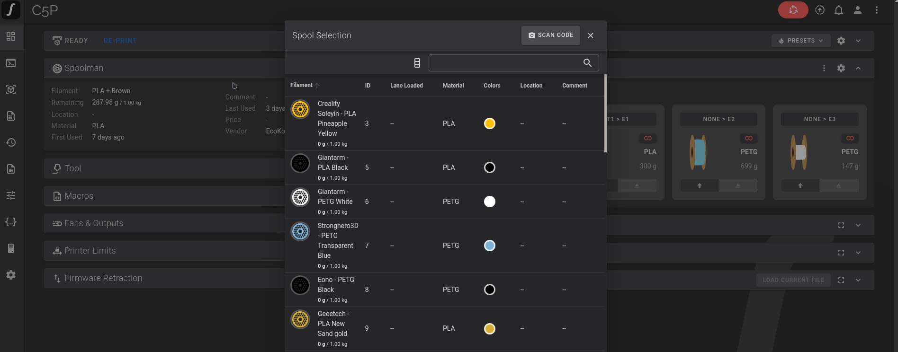
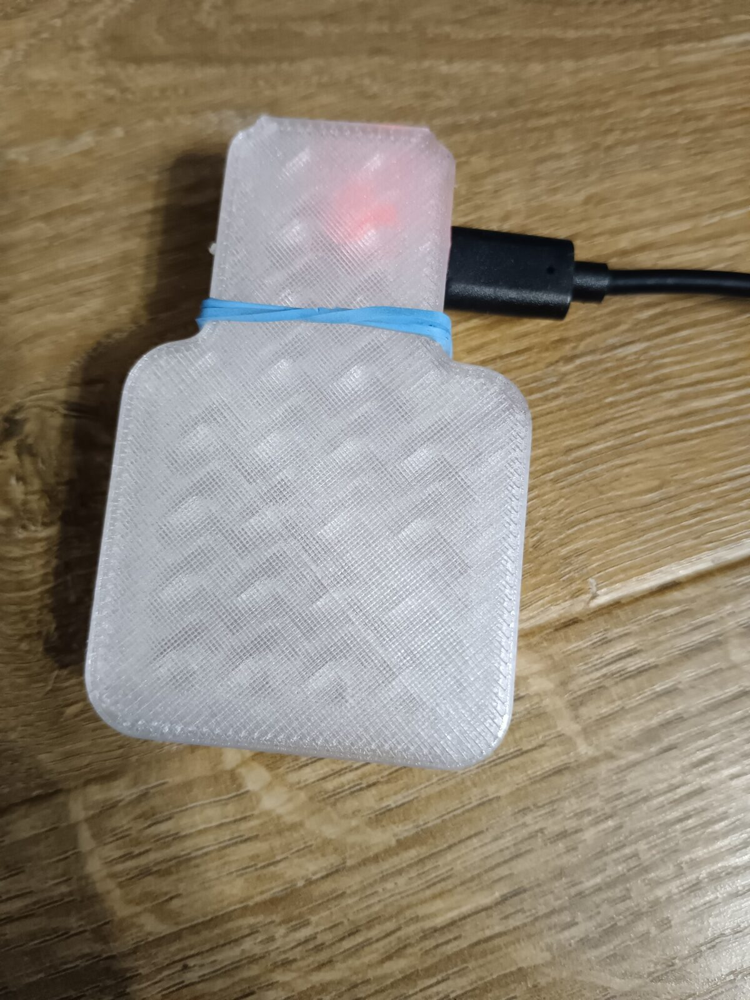
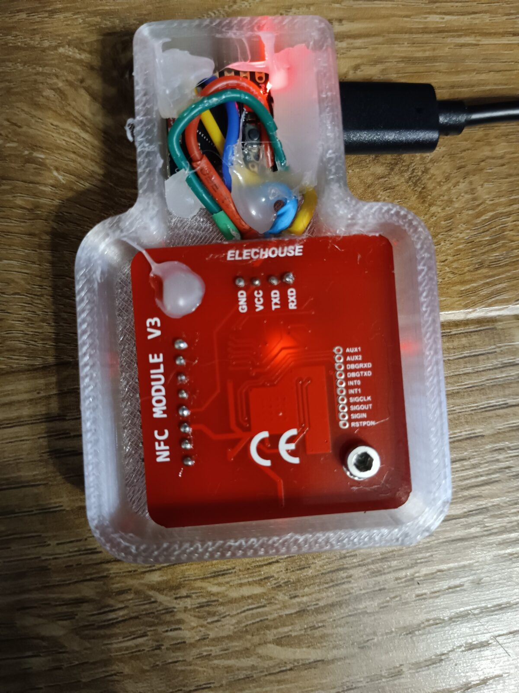
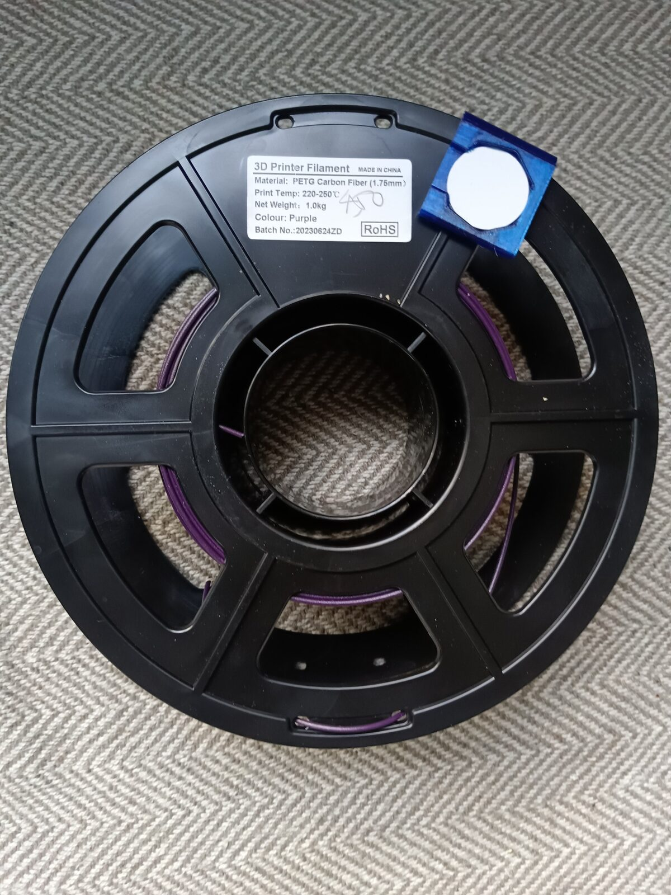
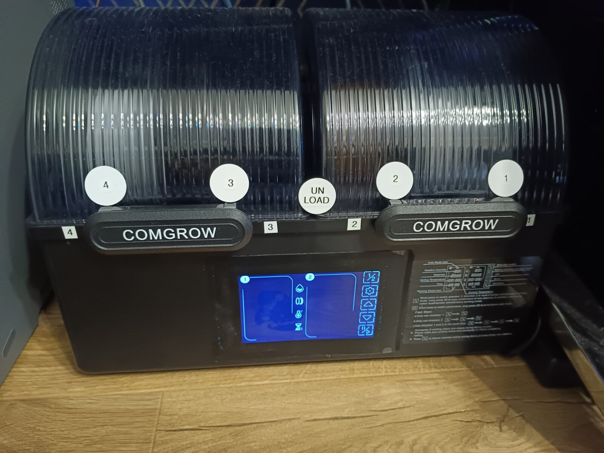

# Spoolman + Klipper/Moonraker + Home Assistant — NFC spool tagging

> **Disclaimer:** I am not a programmer but use AI for my benefit! If you are ok with it then proceed — or well, not!

Tap an NFC tag on a filament spool and let Home Assistant keep Spoolman, a dual-chamber dryer and a multi-toolhead Klipper printer in sync — **which spool is in which dryer slot, and which spool the printer is actually printing from, toolhead by toolhead.**

A button-less ESP32-C3 reader with a PN532 reads the tag's UID and hands it to Home Assistant. HA looks the UID up in Spoolman, records the spool's dryer slot, and (during a print) swaps the printer's active spool as the active toolhead changes.

This is a companion to my [sovol-sh03-dryer](https://github.com/speed007/sovol-sh03-dryer) project — that one controls the dryer; this one tracks what's *in* it. Together they close the loop between the physical spools, Spoolman and the printer.

## Status

Working. Tag taps set a spool's dryer slot, unload tells you which bag to put it back in, and toolhead changes swap the printer's active spool. See [Known issues](#known-issues) before trusting it in a long unattended print.

## How it works

```
NTAG215 on spool ──tap──► ESP32-C3 + PN532 ──POST {uid}──► HA webhook
                                                              │
                       UID ──► Spoolman `card_uids` ───────────┤
                                                              ▼
                        ┌──────────── armed action ────────────┐
                        │ slot 1-4  → set spool's `slot`       │
                        │ unload    → clear `slot` + Telegram  │
                        │ printer   → set that printer's spool │
                        │ (nothing) → manual active spool      │
                        └──────────────────────────────────────┘
                                        │
              active toolhead changes ──┴──► set that tool's spool active
```

Tags are **UID-only** — the tag carries no data, so "reassigning" a tag is a single field update in Spoolman and the tag can never go stale.

Three ideas do the heavy lifting:

- **`card_uids`** (a Spoolman spool custom field) maps a tag UID to a spool.
- **`slot`** (a second custom field) holds the dryer slot when a spool is loaded, and is empty when it is in storage.
- **`location`** (Spoolman's built-in field) is the **storage bag**, set once by hand and never touched by a tap.

## Screenshots

Fluidd's **Spool Selection** dialog, populated straight from Spoolman:


Spool cards showing the Spoolman image and the loaded lane:



## Hardware

| Part | Detail |
| --- | --- |
| Reader | **ESP32-C3** (`esp32-c3-devkitm-1`) running ESPHome |
| NFC | **PN532** over I²C (`GPIO20` SDA / `GPIO21` SCL) |
| Tags | NTAG215 (ISO 14443A), one per spool, tap-only (~cm) |
| Dryer | A dual-chamber dryer exposing four slots — four "slot" tags, one per chamber side |
| Printer | Klipper/Moonraker, multi-toolhead, with the Z-Mod fork on the FF Creator 5 Pro |

> ⚠️ NTAG215 is tap-only. If you want a metre of range you want ISO 15693 (ICODE SLIX2 / the OpenPrintTag standard) and a PN5180 instead — that is a different project.

### In pictures

The finished reader:



Inside — a PN532 **V3** on I²C alongside the ESP32-C3:



The tag in its spool holder, and the slot tags on the dryer:




*More: [`docs/images/`](docs/images/README.md).*

## Wiring

| ESP32-C3 | PN532 | Notes |
| --- | --- | --- |
| GPIO20 | SDA | I²C data |
| GPIO21 | SCL | I²C clock |
| 3V3 | VCC | PN532 is 3.3 V |
| GND | GND | common ground |

The reader is deliberately **button-less**: it only ever sends a UID. Which slot (or unload) a tap applies to is armed in Home Assistant, so the ESP never needs reflashing when the workflow changes.

## Flashing

```
cp secrets.yaml.example secrets.yaml   # then edit it
esphome run spoolmannfc.yaml
```

The ESPHome device is `SpoolmanNFC`; it also runs `bluetooth_proxy` so it doubles as a BLE bridge. You need five secrets — see [`secrets.yaml.example`](secrets.yaml.example).

## Home Assistant setup

### 1. Spoolman custom fields

Two text custom fields on **spool**:

```
quality            # optional, free-form
card_uids          # the tag UID (upper case, no separators)
slot               # the dryer slot when loaded, empty otherwise
```

Create them in Spoolman under *Settings → Custom fields*, type `text`.

### 2. The package

[`ha_nfc_spool.yaml`](ha_nfc_spool.yaml) is a drop-in HA **package** — helpers, rest commands, the active-tool sensor and the three automations. Drop it into `config/packages/` and make sure `configuration.yaml` loads packages:

```yaml
homeassistant:
  packages: !include_dir_named packages
```

**Replace the placeholders:** the three host addresses (Spoolman, the multi-tool printer, the single-tool printer) and the example tag UIDs in `spool_slot_tags`.

### 3. Telegram

Notifications go to Telegram. In Home Assistant 2026.x the bot is a **UI config-entry** — YAML `telegram_bot:` is rejected with *"does not support YAML setup"*:

1. `@BotFather` → `/newbot` → copy the HTTP API token.
2. *Settings → Devices & services → Add integration → Telegram bot* → paste the token.
3. Add your chat id as a **subentry** (the card, then add a chat id). This is what allowlists the chat — without it, sends fail with *"No allowed chat IDs found"*.

If you would rather not use Telegram, delete the `telegram_bot.send_message` steps; the `logbook.log` steps remain as feedback.

### 4. Spoolman integration

Add the Spoolman integration (HACS: `Disane87/spoolman-homeassistant`). Extra-field entities (`sensor.spoolman_spool_<id>_extra_card_uids`, `..._extra_slot`) only appear **after a reload**, and only once that field is actually set on a spool — the automations trigger a reload themselves after writing.

## Slot ↔ toolhead map

The dryer feeds all four toolheads. Slot numbering maps to the printer's tool ids like this — adjust the table in `ha_nfc_spool.yaml` for your own machine:

| Dryer slot | Tool | Name |
| --- | --- | --- |
| 4 | T4 | `DRYER1-L` |
| 3 | T3 | `DRYER1-R` |
| 2 | T2 | `DRYER2-L` |
| 1 | T1 | `DRYER2-R` |

## Tag map

`input_text.spool_slot_tags` is a JSON object, **tag UID → action**:

| Value | Tag | Meaning |
| --- | --- | --- |
| `1`–`4` | one per dryer slot | arm that slot |
| `0` | the **unload** tag | clear the spool's slot, tell the operator the bag |
| `5` | the **second-printer** tag | send the spool to the single-tool printer |

Any tag not in the map is treated as a spool tag.

## Daily use

- **Load** — tap the slot's tag, then tap the spool's tag. The spool's `slot` is set; its bag `location` is untouched.
- **Unload** — tap the unload tag, then the spool's tag. `slot` is cleared, and Telegram tells you which bag it goes back to.
- **Second printer** — tap its tag, then the spool's tag. It becomes that printer's active spool.
- **Manual** — tap a spool's tag with nothing armed, and it becomes the multi-tool printer's active spool.
- **While printing** — every toolhead change re-points the printer's active spool at that tool's slot.

A spare RF remote can also arm slots 1–4 (see `rf_spool_slot_select`), purely as a backup to the tags.

## CLI helper

`spoolman_tags.py` maps tags to spools outside Home Assistant:

```
export SPOOLMAN_URL=http://spoolman.local:7912
./spoolman_tags.py list
./spoolman_tags.py lookup   04A1B2C3D40100
./spoolman_tags.py assign   29 04A1B2C3D40100
./spoolman_tags.py clear    29
```

Gotcha: Spoolman stores extra-field values **JSON-encoded** (so a UID is written as `"\"04A1…\""`). The helper handles that — and UID normalisation (no `:`, no `-`, upper case) — for you.

## Repository layout

```
spoolmannfc.yaml      ESPHome firmware for the reader
ha_nfc_spool.yaml     Home Assistant package (helpers, rest commands, automations)
spoolman_tags.py      tag <-> spool CLI helper
secrets.yaml.example  the secrets the firmware needs
docs/images/          screenshots and video — see its README
NOTICE                third-party material and safety notes
```

## Known issues

- **3 s toolhead lag.** The active-tool sensor polls Moonraker every 3 seconds, so a tool change is picked up a few seconds late.
- **The webhook id is a password.** Anyone who knows your webhook URL can post tags. Use a long random id (see `secrets.yaml.example`) and keep Home Assistant off the public internet — the automation is `local_only`.
- **NTAG215 range is centimetres.** You must touch the tag to the reader; that is the trade-off for a cheap, thin, spool-friendly tag.
- **String/int trap.** Automation `variables` render as **strings**, so every comparison in the package coerces with `| int(...)`. Drop that and `"0" == 0` silently evaluates false.
- **Rename gotcha.** The firmware's fallback-hotspot secret was originally named after an unrelated device; it is now `ap_password`. Update your `secrets.yaml` to match.
- **Placeholders.** Hosts and example tag UIDs in `ha_nfc_spool.yaml` are placeholders — replace them before use.
- **Ad-blockers can break Spoolman live updates.** Fluidd (and Mainsail) fetch live spool data over a **WebSocket** straight from the browser to Spoolman. uBlock Origin and similar extensions can block the upgrade while still letting ordinary HTTP through — so the API looks fine but spool weights stop refreshing. Disable the blocker for the Fluidd origin, or add `@@||<spoolman-host>^` to its filter list.

## Contributing

Bug reports, fixes and improvements are very welcome — small and focused changes are easiest to review. Not sure where to start? Open an issue and we'll figure it out.

## Credits

Wired, flashed and scripted by me. Built with [ESPHome](https://esphome.io/), [Spoolman](https://github.com/Donkie/Spoolman), [Moonraker](https://github.com/Arksine/moonraker) and Home Assistant. The dryer it pairs with lives in [sovol-sh03-dryer](https://github.com/speed007/sovol-sh03-dryer).

## Disclaimer

Unaffiliated with Comgrow, Sovol, FlashForge, NXP or any other manufacturer named here. Product names are used for identification only. Modifying printers and dryers is done entirely at your own risk.

## Licence

MIT — see [`LICENSE`](LICENSE). Third-party material (any media later added under
`docs/images/`) is covered by [`NOTICE`](NOTICE), not MIT.

## Support

If this project saved you some time, you can buy me a coffee — it's much appreciated and keeps the tinkering going.

[](https://ko-fi.com/Q2Z82939Y7)
